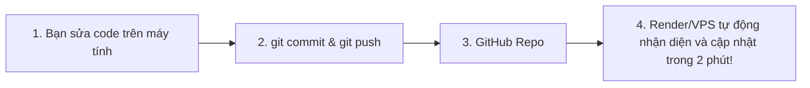

# HƯỚNG DẪN TRIỂN KHAI (DEPLOY) & MỞ RỘNG WEB WORDSAN.ME

Tài liệu này hướng dẫn chi tiết cách chạy thử nghiệm, đưa hệ thống lên web với tên miền **`wordscan.me`** trên Namecheap, và quy trình cập nhật liên tục (CI/CD) mỗi khi mở rộng tính năng mới.

---

## 🌟 TỔNG QUAN KIẾN TRÚC HỆ THỐNG

```
[Trình duyệt của Giáo viên / Admin]
                │
                ▼
  https://wordscan.me (Namecheap DNS)
                │
                ▼
   [Cloud Server / VPS (Docker / FastAPI)]
    ├── Web UI (TailwindCSS + JavaScript)
    ├── Auth & Role Management (SQLite: Admin & Giáo viên)
    ├── Quỹ Google Gemini API Keys dùng chung
    └── Core AI Engine (Bóc tách LaTeX OMML + AI vẽ hình 3D + Word Builder)
```

* **👑 Quyền Quản trị viên (Admin):** Cấp phát/khóa tài khoản giáo viên, quản lý quỹ Google Gemini API Key dùng chung, xem nhật ký tài liệu toàn trung tâm.
* **👨‍🏫 Quyền Giáo viên (User):** Đăng nhập, kéo thả PDF/ảnh đề thi, chọn các chế độ (tiết kiệm giấy, vẽ lại hình, bóc 2 cột), theo dõi tiến trình thời gian thực và tải file Word (.docx).

---

## 1. CHẠY THỬ NGHIỆM TRÊN MÁY TÍNH CỦA BẠN (LOCAL)

Trước khi đưa lên máy chủ Internet, bạn có thể chạy thử trực tiếp trên máy:

### Cách 1: Chạy bằng file Click đúp
* Nhấp đúp vào file **`CHAY_WEB.bat`** trong thư mục dự án.

### Cách 2: Chạy bằng dòng lệnh
```bash
python run_web.py --port 8000
```

Mở trình duyệt truy cập: **`http://localhost:8000`**
* **Tài khoản Admin mặc định:**
  * **Tên đăng nhập:** `admin`
  * **Mật khẩu:** `admin123`
*(Bạn có thể đổi mật khẩu và tạo thêm tài khoản giáo viên trong trang Quản trị).*

---

## 2. PHƯƠNG ÁN DEPLOY LÊN WEB TỐI ƯU NHẤT: CLOUD PAAS (RENDER HOẶC RAILWAY)

> **Khuyên dùng:** Đây là phương án nhanh nhất, dễ nhất và không cần quản trị server Linux phức tạp. Tự động cấp chứng chỉ bảo mật SSL HTTPS miễn phí cho tên miền `wordscan.me`.

### Bước 2.1: Đẩy mã nguồn lên GitHub (Private Repository)
1. Tạo một repository mới trên GitHub (chọn chế độ **Private** để bảo vệ mã nguồn).
2. Đẩy toàn bộ thư mục dự án lên GitHub:
   ```bash
   git add .
   git commit -m "feat: Ra mat he thong Web WordScan.me voi phan quyen admin/user"
   git branch -M main
   git remote add origin https://github.com/TÊN_GITHUB_CỦA_BẠN/TÊN_REPO.git
   git push -u origin main
   ```

### Bước 2.2: Triển khai trên Render.com
1. Đăng ký tài khoản miễn phí tại **[Render.com](https://render.com)** (đăng nhập bằng GitHub).
2. Bấm nút **New +** $\rightarrow$ chọn **Web Service**.
3. Chọn Repository vừa tạo ở Bước 2.1.
4. Cấu hình các thông số:
   * **Name:** `wordscan`
   * **Region:** Singapore (gần Việt Nam, tốc độ cao nhất)
   * **Runtime:** `Docker` (Render sẽ tự động dùng file `Dockerfile` có sẵn trong dự án)
   * **Instance Type:** Gói Starter ($7/tháng) hoặc gói Free để thử nghiệm.
5. Bấm **Create Web Service**. Chờ 2 - 3 phút để hệ thống tự động build và chạy.

---

## 3. CẤU HÌNH TÊN MIỀN NAMECHEAP `wordscan.me`

Sau khi Web Service trên Render/Railway đã chạy:

1. Trong trang quản lý của Render, vào mục **Settings** $\rightarrow$ **Custom Domains** $\rightarrow$ bấm **Add Custom Domain** $\rightarrow$ nhập: `wordscan.me` và `www.wordscan.me`.
2. Render sẽ cung cấp cho bạn thông số DNS (Bản ghi CNAME hoặc IP).
3. Đăng nhập vào **[Namecheap Dashboard](https://ap.www.namecheap.com)**:
   * Vào mục **Domain List** $\rightarrow$ Bấm nút **MANAGE** cạnh tên miền `wordscan.me`.
   * Chuyển sang tab **Advanced DNS**.
   * Thêm 2 bản ghi sau:
     * **Bản ghi 1:** Type: `CNAME Record` | Host: `www` | Value: `[địa chỉ render cung cấp, ví dụ: wordscan.onrender.com]` | TTL: `Automatic`.
     * **Bản ghi 2:** Type: `A Record` (hoặc `ALIAS/ANAME`) | Host: `@` | Value: `[IP render cung cấp]` | TTL: `Automatic`.
4. Bấm **Save all changes**. Sau 5 - 15 phút, bạn có thể truy cập thẳng vào **`https://wordscan.me`** với ổ khóa xanh HTTPS bảo mật!

---

## 4. PHƯƠNG ÁN DEPLOY BẰNG VPS RIÊNG (UBUNTU DOCKER)

Nếu trung tâm muốn dùng VPS riêng (Vietnix, TinoHost, DigitalOcean, Hetzner...):

1. **Cài đặt Docker trên VPS:**
   ```bash
   curl -fsSL https://get.docker.com -o get-docker.sh
   sh get-docker.sh
   ```
2. **Clone mã nguồn về VPS:**
   ```bash
   git clone https://github.com/TÊN_GITHUB_CỦA_BẠN/TÊN_REPO.git /app/wordscan
   cd /app/wordscan
   ```
3. **Khởi chạy container:**
   ```bash
   docker compose up -d --build
   ```
4. **Cài đặt Nginx & SSL Certbot (miễn phí Let's Encrypt):**
   * Trỏ IP của VPS vào bản ghi A Record của tên miền `wordscan.me` trên Namecheap.
   * Chạy lệnh Certbot để bật HTTPS:
     ```bash
     sudo certbot --nginx -d wordscan.me -d www.wordscan.me
     ```

---

## 5. QUY TRÌNH MỞ RỘNG VÀ CẬP NHẬT TỰ ĐỘNG (CI/CD)

Bạn hoàn toàn có thể yên tâm nâng cấp, bổ sung tính năng mới bất cứ lúc nào:



* **Nếu dùng Cloud PaaS (Render / Railway):**
  Mỗi khi bạn sửa code, thêm giao diện, hoặc nâng cấp AI, bạn chỉ cần chạy:
  ```bash
  git add .
  git commit -m "Mô tả tính năng mới cập nhật"
  git push
  ```
  Hệ thống Render sẽ **tự động phát hiện code mới và cập nhật lên web** mà bạn không cần phải đăng nhập vào server hay thao tác thủ công gì thêm!

* **Nếu dùng VPS riêng:**
  Chúng tôi đã viết sẵn file script **`update.sh`**. Khi muốn cập nhật, bạn chỉ cần gõ 1 dòng lệnh duy nhất trên VPS:
  ```bash
  ./update.sh
  ```
  Hệ thống sẽ tự động kéo code mới nhất, build lại Docker và kích hoạt mà không làm gián đoạn dữ liệu đã lưu.
